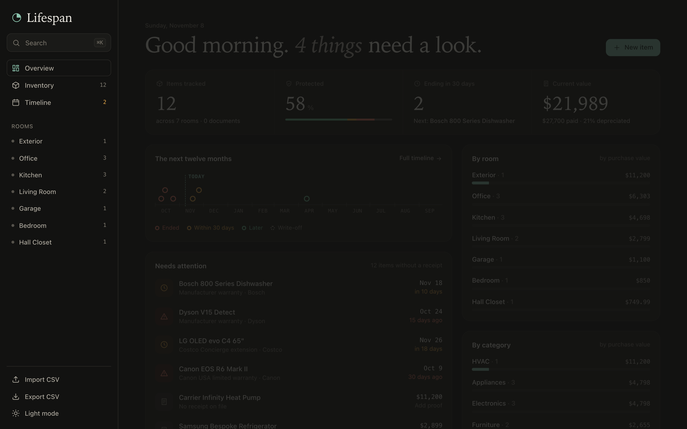
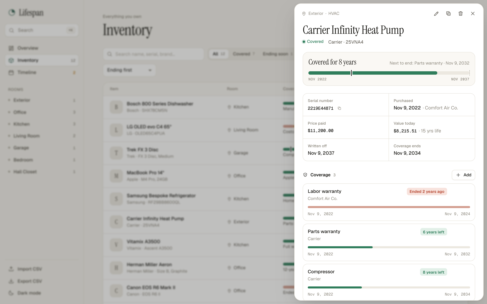
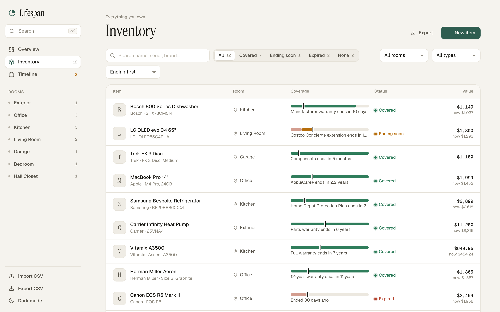
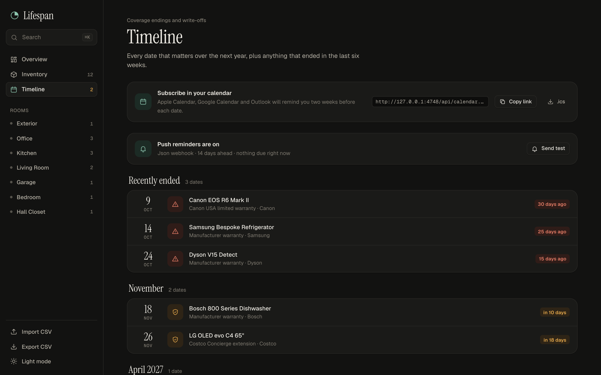
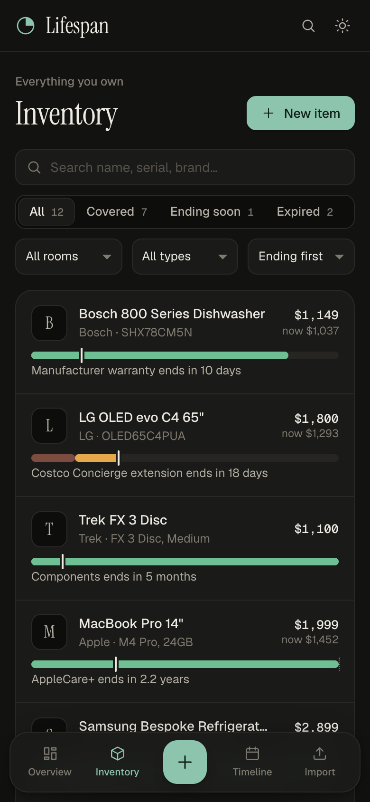
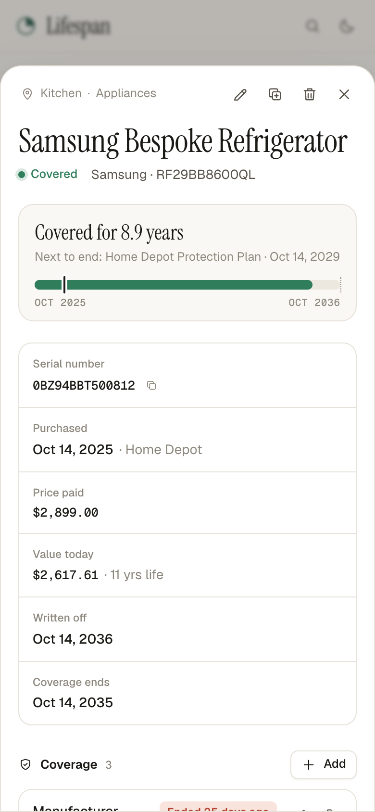

<div align="center">

# Lifespan

**Know when your things are covered.**

A calm, self-hosted home inventory that keeps every warranty, receipt, manual and write-off date for the things you own, and tells you before coverage runs out — not the week after it breaks.

[](https://github.com/Sun-sh902/lifespan/actions/workflows/ci.yml)
[](LICENSE)




</div>

## Why

Most products come with more than one promise attached. A refrigerator has a one-year full warranty, a ten-year compressor warranty and maybe a store protection plan, all ending on different days. The receipt is in a drawer, the manual is in a box in the garage, and the serial number is behind the appliance.

The self-hosting community keeps asking warranty trackers for the same things, and Lifespan is built around them:

- **Several warranties per item**, each with its own start and end date
- **Several documents per item** — receipt, warranty card, manual, photos
- **Room and serial number** for every item
- **Write-off dates** with straight-line depreciation, for insurance and small-business records
- **Reminders where you already look** — a subscribable calendar feed and push notifications to Discord, Slack or ntfy
- **Your data stays yours** — one SQLite file, CSV import and export that round-trips

## Screenshots

| Item detail | Inventory |
| --- | --- |
|  |  |

| Timeline | Phone |
| --- | --- |
|  |   |

## Features

- **Overview** — what needs attention, a twelve-month horizon of coverage endings, value after depreciation, and breakdowns by room and category.
- **Inventory** — instant search across names, serials, brands and warranty providers; filters by status, room and category; a *lifespan bar* on every item showing each warranty window and today.
- **Item detail** — layered coverage with per-warranty progress, drag-and-drop documents (up to 25 MB each, images preview inline), one-click serial copy, duplicate for things you bought several of, and a shareable link (`#/inventory?item=12`).
- **Timeline** — every coverage ending and write-off date grouped by month.
- **Calendar feed** — subscribe to `/api/calendar.ics` from Apple Calendar, Google Calendar or Outlook; each event carries a 14-day alert.
- **Push reminders** — an hourly check posts one digest per warranty end date to a webhook, never repeating itself.
- **CSV import and export** — imports are all-or-nothing and report every problem by row; exported files import back unchanged.
- **Keyboard first** — `⌘K` or `/` for the command palette, `N` for a new item, `Esc` to close.
- Light and dark themes, phone layout with a bottom tab bar and sheet-style details, reduced-motion support.

## Quick start

### Node

Requires **Node.js 22.13 or newer** (it uses the built-in `node:sqlite`). There is nothing to install.

```bash
git clone https://github.com/Sun-sh902/lifespan.git
cd lifespan
npm start
```

Open <http://127.0.0.1:4747> and choose **Explore with sample data**, or add your first item.

### Docker

```bash
docker compose up -d
```

Data is stored in `./data`. Edit `compose.yaml` to set the options below.

## Configuration

| Variable | Default | Purpose |
| --- | --- | --- |
| `PORT` | `4747` | HTTP port |
| `HOST` | `127.0.0.1` | Bind address; use `0.0.0.0` to reach it from other devices |
| `LIFESPAN_DATA_DIR` | `./data` | SQLite database and uploaded files |
| `LIFESPAN_ALLOWED_HOSTS` | loopback names when bound to loopback, otherwise any | Comma-separated host names the server answers to (`*` for any). Set this when exposing Lifespan, to refuse DNS rebinding |
| `LIFESPAN_WEBHOOK_URL` | *(off)* | Where to post reminders |
| `LIFESPAN_WEBHOOK_FORMAT` | `auto` | `auto`, `discord`, `slack`, `text` (ntfy) or `json` |
| `LIFESPAN_REMIND_DAYS` | `14` | How many days ahead to remind |

### Push reminders

Point `LIFESPAN_WEBHOOK_URL` at any of these and Lifespan detects the format:

```bash
LIFESPAN_WEBHOOK_URL=https://discord.com/api/webhooks/…   npm start
LIFESPAN_WEBHOOK_URL=https://hooks.slack.com/services/…    npm start
LIFESPAN_WEBHOOK_URL=https://ntfy.sh/your-private-topic    npm start
```

Any other URL receives JSON: `{ "text": "...", "events": [ { "item_name", "label", "provider", "date", "days_left", ... } ] }`. The Timeline page shows whether reminders are on and has a **Send test** button. Changing a warranty's end date re-arms its reminder.

### Backups

Everything lives in the data directory: copy it while the server is stopped, or use CSV export for a portable copy of items and warranties.

## Verification

```bash
npm test            # 40 unit and API tests, in-process with a fixed clock
npm run acceptance  # 17 end-to-end checks against a real server process
```

The acceptance run starts the server on a throwaway data directory with a local stand-in webhook, then walks through creating, validating, uploading, editing, searching, importing, duplicating, reminding, exporting, restarting and deleting, plus security checks for path traversal, cross-origin writes, unknown Host headers and oversized bodies. CI runs both on Node 22 and 24 and smoke-tests the Docker image.

## API

JSON in and out unless noted. Errors look like `{ "error": { "code", "message", "fields"?, "rows"? } }`. Prices are integer cents, dates are `YYYY-MM-DD`, and a coverage is *ending soon* within 30 days of its end.

| Method | Path | Description |
| --- | --- | --- |
| GET | `/api/health` | Liveness and server date |
| GET | `/api/dashboard` | Counts, values, timeline, room and category breakdowns |
| GET | `/api/meta` | Distinct rooms, categories, brands, retailers, providers |
| GET | `/api/items` | List. Query: `q`, `status` (`covered`, `expiring`, `expired`, `none`), `location`, `category`, `sort` (`expiry`, `name`, `value`, `purchased`, `recent`) |
| POST | `/api/items` | Create, optionally with a `coverages` array |
| GET / PATCH / DELETE | `/api/items/:id` | Read, partially update, delete (removes coverages and files) |
| POST | `/api/items/:id/duplicate` | Copy an item and its coverages (not its serial or files) |
| POST | `/api/items/:id/coverages` | Add a coverage |
| PATCH / DELETE | `/api/coverages/:id` | Update or remove a coverage |
| POST | `/api/items/:id/documents?kind=receipt` | Upload the raw file body with `Content-Type` and a URL-encoded `X-Filename` |
| GET | `/api/documents/:id/file` | View (images and PDFs inline) or `?download` |
| DELETE | `/api/documents/:id` | Delete a document |
| GET | `/api/export.csv` | Export as CSV |
| POST | `/api/import` | Import CSV (the body is the CSV text) |
| GET | `/api/calendar.ics` | iCalendar feed |
| GET | `/api/reminders` | Reminder settings and what is due |
| POST | `/api/reminders/run` | Send due reminders now |
| POST | `/api/reminders/test` | Send a test message |
| POST | `/api/demo` | Load the sample household (empty inventory only) |

## Project layout

```
server/
  index.js        entry point and configuration
  app.js          HTTP server, routes, static files
  db.js           SQLite schema
  domain.js       date math, coverage status, depreciation (pure functions)
  validation.js   input validation
  reminders.js    webhook formats and delivery
  csv.js, ics.js  file formats
  demo.js         sample household
public/           the web app (no framework, no build step)
test/             node:test suites
scripts/          acceptance run and seeding
```

## Security

Lifespan has no accounts and is built for a trusted home network. It listens on localhost by default, refuses unknown Host headers and cross-origin writes, sends a strict Content-Security-Policy, serves only images and PDFs inline (everything else downloads, sandboxed), neutralizes spreadsheet formulas on export, and caps request sizes. To reach it from outside your machine, put it behind a reverse proxy with authentication. See [SECURITY.md](SECURITY.md).

## Contributing

Issues and pull requests are welcome — see [CONTRIBUTING.md](CONTRIBUTING.md).

## License

[MIT](LICENSE)
